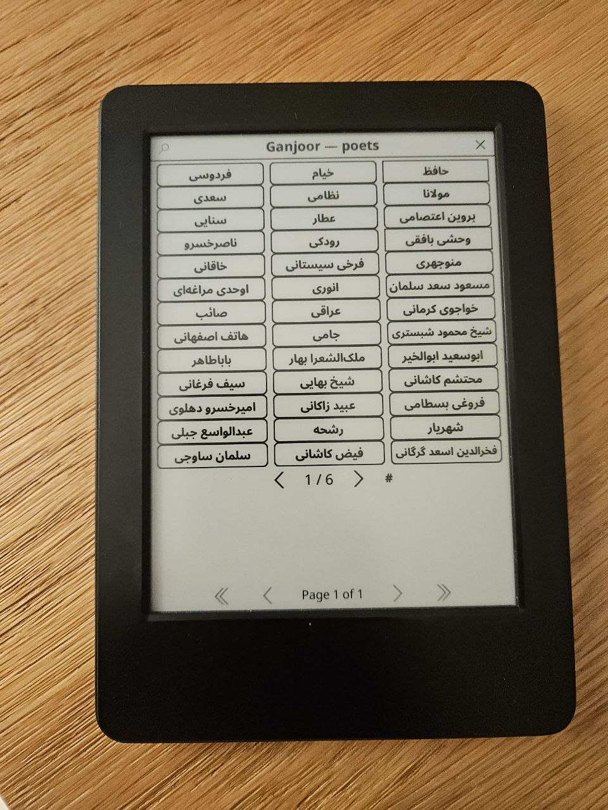
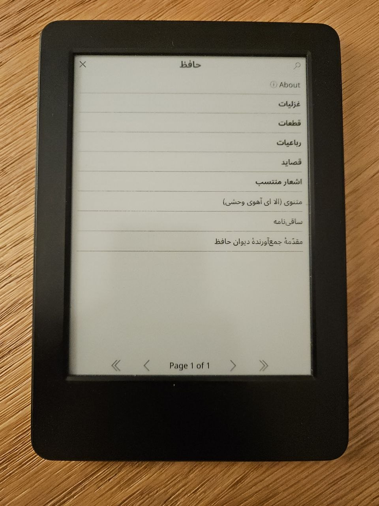
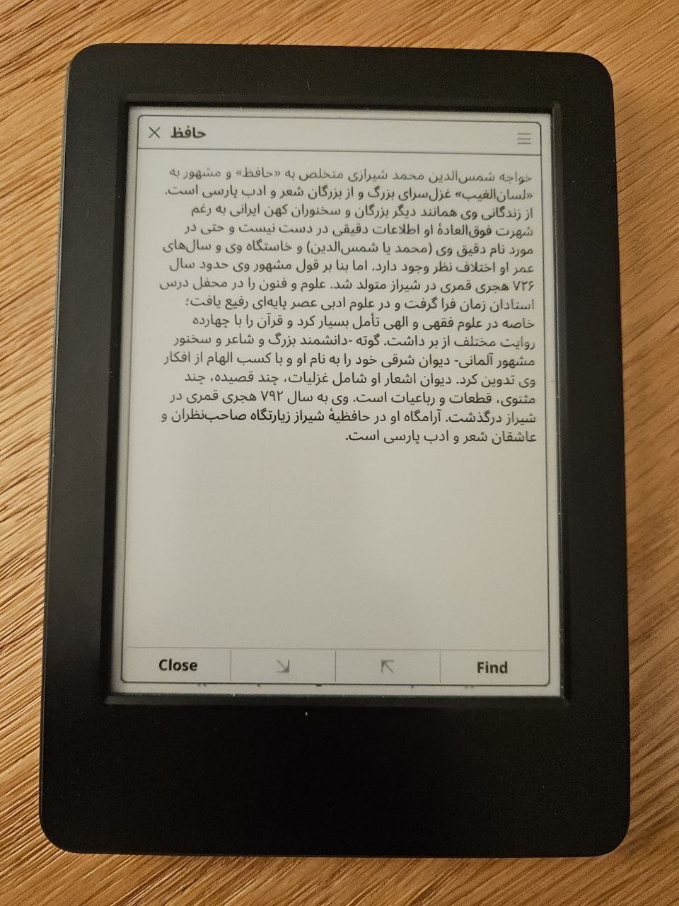
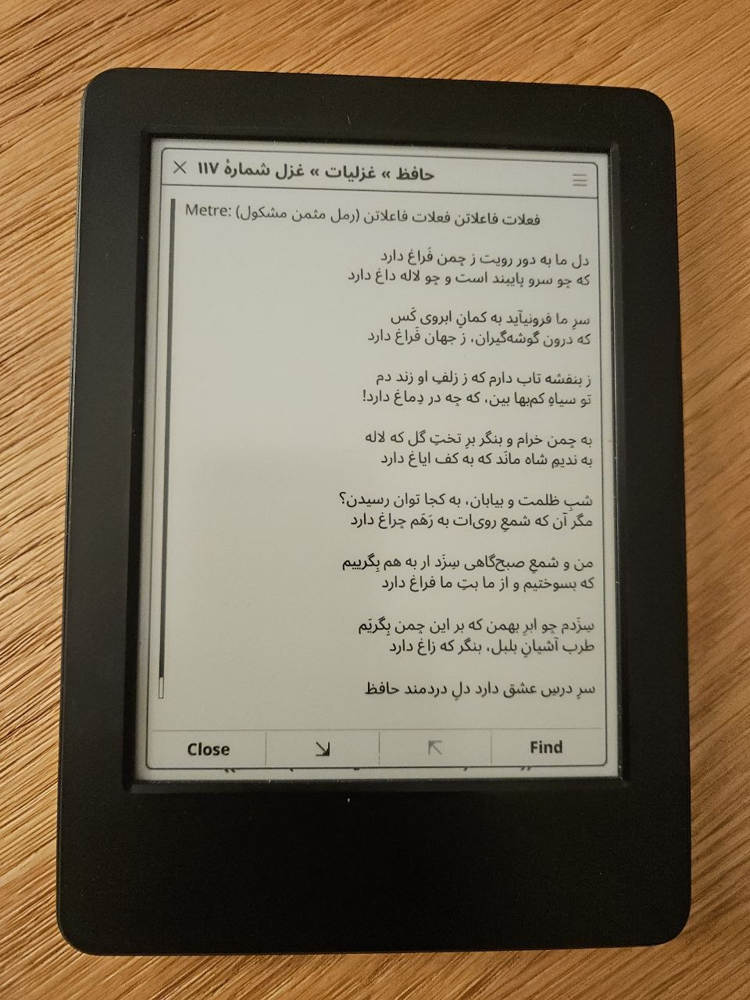

# گنجور برای KOReader — Ganjoor for KOReader

<p align="center">
  
  
  
  
</p>

<div dir="rtl">

## فارسی

افزونه‌ای برای [KOReader](https://koreader.rocks) برای خواندن شعر کلاسیک فارسی از
[گنجور](https://ganjoor.net) روی کتاب‌خوان‌های الکترونیکی. داده‌ها از
[`ganjoor-data`](https://github.com/ganjoor/ganjoor-data) (نسخهٔ عمومی و ایستای گنجور) می‌آید —
بدون سرور و بدون حساب کاربری.

### امکانات

- **۲۰ سخنور از همان ابتدا آفلاین**: حافظ، سعدی، مولانا، فردوسی، خیام، نظامی، پروین اعتصامی، سنایی،
  وحشی بافقی، رودکی، باباطاهر، عبید زاکانی، عراقی، شبستری، انوری، خاقانی، منوچهری،
  ابوسعید ابوالخیر، هاتف اصفهانی و فروغی بسطامی — جمعاً حدود ۱۷ هزار شعر و ۶۱ مگابایت.
- **بقیهٔ سخنوران قابل دانلود**: روی سخنوری که کنارش «↓» است بزنید و «دانلود برای خواندن آفلاین» را
  انتخاب کنید. دانلود قابل توقف و ازسرگیری است (با لمس صفحه متوقف می‌شود) و بعد از آن سخنور
  دقیقاً مثل سخنوران درون‌ساخت، آفلاین و جست‌وجوپذیر است. حذف دانلودها از «سخنوران و دانلودها».
  اگر نخواهید دانلود کنید، «مرور آنلاین» هم هست.
- **نمایش شعر مثل شعر**: مصرع‌ها دو ستونه و کنار هم (مصرع اول سمت راست)، بیت زیر بیت، با وزن عروضی،
  نثرها و توضیحات جدا. سبک خواندن در «Reading settings ← Layout» قابل انتخاب است: **دو ستونه** (پیش‌فرض)،
  **پلکانی** (مصرع اول در خط اول سمت راست، مصرع دوم در خط دوم سمت چپ) و **وسط‌چین، یک مصرع در هر سطر**
  (مناسب صفحه‌های باریک).
- **جابه‌جایی راست‌به‌چپ، فقط با لمس صفحه**: لمس **سمت راست** صفحه (یا کشیدن انگشت به راست) = بعدی؛
  لمس **سمت چپ** (یا کشیدن به چپ) = قبلی. شعر بلند قسمت‌به‌قسمت جلو می‌رود و بعد از آخرین قسمت
  خودکار شعر بعدی باز می‌شود و پیامی «Next poem: …» نشان می‌دهد. برگشتن از ابتدای یک شعر، به **انتهای**
  شعر قبلی می‌رود. **لمس وسط صفحه** منوی شعر را باز می‌کند (تنظیمات خواندن، نشانه‌گذاری، شعر قبلی/بعدی).
- **جست‌وجو در متن همهٔ شعرهای آفلاین**: نیم‌فاصله، فاصله، اعراب و «ي/ك» عربی اهمیتی ندارد. نتیجه شعر را
  باز می‌کند و بیت پیدا‌شده را پررنگ می‌کند. می‌توانید فقط در یک سخنور جست‌وجو کنید (اولین گزینهٔ منوی سخنور).
  ذره‌بین نوار عنوان همچنان همان فهرست باز را فیلتر می‌کند.
- **نشانه‌گذاری (بوکمارک)**: ستارهٔ نوار عنوان شعر را نشان می‌کند؛ نگه‌داشتن انگشت روی یک بیت، همان بیت را.
  فهرست نشانه‌ها در منو؛ نگه‌داشتن روی یک مورد، حذفش می‌کند. شعرهای نشان‌شده‌ٔ آنلاین آفلاین هم می‌مانند.
- **انتخاب فونت**: «تنظیمات خواندن» ← فونت. همهٔ فونت‌های KOReader فهرست می‌شوند، فونت‌هایی که فارسی دارند
  اول می‌آیند و پیش از انتخاب پیش‌نمایش یک بیت را می‌بینید. اندازهٔ قلم، چیدمان و نمایش اعراب هم قابل تنظیم است.
- **ادامهٔ خواندن**: «Continue reading» شما را به همان شعر و صفحه‌ای که بودید برمی‌گرداند؛ دکمهٔ شعر قبلی/بعدی از جستجو و نشانه‌ها هم کار می‌کند.
- **فال حافظ** و **شعر تصادفی** از منوی افزونه.
- **راست‌به‌چپ در همه‌جا**، حتی وقتی زبان رابط KOReader انگلیسی است.

### نصب

۱. پوشهٔ `ganjoor.koplugin` را (همراه پوشهٔ `data` داخلش) در پوشهٔ افزونه‌های KOReader کپی کنید:

| دستگاه | مسیر |
|---|---|
| Kobo | `‎.adds/koreader/plugins/` |
| Kindle | `koreader/plugins/` |
| PocketBook | `applications/koreader/plugins/` |
| Android | `koreader/plugins/` |
| Linux/macOS | `‎~/.config/koreader/plugins/` |

۲. KOReader را دوباره باز کنید. ۳. از منوی بالا، بخش جست‌وجو/ابزارها، **Ganjoor poetry**.

### استفاده با Simple UI (زبانه در نوار ناوبری)

گنجور به‌صورت «اکشن سیستمی» KOReader معرفی شده، پس در [Simple UI](https://github.com/doctorhetfield-cmd/simpleui.koplugin)
قابل انتخاب است (و در مدیر ژست‌های خود KOReader هم):

۱. **Menu ← Tools ← SimpleUI ← Quick Actions ← Create Quick Action**.
۲. نام بگذارید (مثلاً «گنجور»)، **Action Type ← System Actions** و یکی از این‌ها را انتخاب کنید:
   *Ganjoor poetry* (فهرست شاعران)، *Ganjoor: continue reading*، *Ganjoor: Hafez fal* یا *Ganjoor: search poems*.
   (گزینهٔ **Plugin ← Ganjoor** هم همان فهرست شاعران را باز می‌کند.) سپس **Save**.
۳. همان منوی SimpleUI ← **Navigation Bar** ← تنظیم زبانه‌ها، و اکشنی که ساختید را به یکی از زبانه‌ها بدهید.

همین اکشن را می‌توانید در صفحهٔ اصلی SimpleUI، نوار عنوان یا تب Quick Settings منوی بالای KOReader هم بگذارید.

### فونت فارسی (پیشنهاد: وزیرمتن)

[وزیرمتن](https://rastikerdar.github.io/vazirmatn/) را دانلود کنید و پوشهٔ فایل‌های `‎.ttf` را در
`koreader/fonts` بگذارید؛ بعد از بازکردن دوبارهٔ KOReader در «تنظیمات خواندن ← فونت» دیده می‌شود.

### تغییر فهرست سخنوران درون‌ساخت

```
git clone --depth 1 --filter=blob:none --sparse https://github.com/ganjoor/ganjoor-data.git
cd ganjoor-data && git sparse-checkout set poets/hafez poets/saadi   # هر سخنوری که می‌خواهید
python3 tools/build_offline_data.py --src ganjoor-data --out ganjoor.koplugin/data --poets hafez saadi
```

### محدودیت‌ها

- جست‌وجو فقط در سخنوران روی دستگاه (درون‌ساخت و دانلودشده) کار می‌کند.
- دانلود سخنوران پرکار (مثلاً صائب یا عطار) هزاران درخواست کوچک است و ممکن است ساعت‌ها طول بکشد و صدها
  مگابایت جا بگیرد؛ به همین دلیل قابل توقف و ازسرگیری است.
- «باز کردن شعر با کد گنجور» به اینترنت نیاز دارد.

</div>

---

## English

A [KOReader](https://koreader.rocks) plugin for reading classical Persian poetry from
[Ganjoor](https://ganjoor.net) on e-readers. Content comes from
[`ganjoor-data`](https://github.com/ganjoor/ganjoor-data), Ganjoor's public static data export — no
server, no account.

### Features

- **20 poets built in, readable offline from the first launch**: Hafez, Saadi, Rumi (Molavi), Ferdowsi,
  Khayyam, Nezami, Parvin E'tesami, Sanai, Vahshi, Rudaki, Baba Taher, Obeyd Zakani, Eraqi, Shabestari,
  Anvari, Khaqani, Manuchehri, Abu Sa'id Abu'l-Khayr, Hatef and Foroughi — about 17,000 poems, 61 MB.
- **Every other poet can be downloaded**: tap a poet marked with “↓” and choose *Download for offline
  reading*. Downloads are pausable and resumable (tap the screen to pause) and end up in the same format
  as the built-in poets (offline and searchable). Manage or delete them under *Poets and downloads*.
  *Browse online* still works too.
- **Poems look like poems**: hemistichs in two columns (first hemistich on the right), couplet under
  couplet, metre line, prose and notes set apart. The reading style is selectable under
  *Reading settings → Layout*: **two columns** (default), **staggered** (first hemistich on the first line at the
  right edge, second hemistich on the next line at the left edge) and **centered, one hemistich per line**
  (for narrow screens).
- **Right-to-left navigation, by tapping the page only**: tap the **right** side (or swipe right) = forward,
  tap the **left** side (or swipe left) = back. A long poem advances part by part; after the last part
  the next poem opens automatically with a “Next poem: …” message, and going back from the start of a poem
  lands on the **end** of the previous one. **Tap the middle** of the page for the poem menu (reading
  settings, bookmark, previous/next poem).
- **Full-text search** over every poet stored on the device. Spaces, ZWNJ, diacritics and Arabic ي/ك
  are ignored. A result opens the poem with the matching couplet highlighted; the first entry of a
  poet's menu searches just that poet. The title-bar magnifier still filters the current list.
- **Bookmarks**: the star in the title bar bookmarks a poem, long-pressing a couplet bookmarks that
  couplet. List under the menu; long-press an entry to remove it. Bookmarked poems that were read online
  stay available offline.
- **Font choice**: *Reading settings → Font*. All KOReader fonts are listed, fonts with Persian glyphs
  first, with a preview of a couplet before you pick one. Font size, layout and diacritics are adjustable.
- **Continue reading** returns you to the poem and page you left; previous/next poem also works from search results and bookmarks.
- **Hafez fal** (a random ghazal) and **Random poem** from the plugin menu.
- **RTL throughout**, even when KOReader's UI language is LTR.

### Install

1. Copy the `ganjoor.koplugin` folder (with its `data` folder) into KOReader's plugins directory — paths in
   the table above. 2. Restart KOReader. 3. Top menu → search/tools section → **Ganjoor poetry**.

### Using it with Simple UI (a tab in the navigation bar)

Ganjoor registers itself as a KOReader *system action*, so [Simple UI](https://github.com/doctorhetfield-cmd/simpleui.koplugin)
(and KOReader's own gesture manager) can use it:

1. **Menu → Tools → SimpleUI → Quick Actions → Create Quick Action**.
2. Name it (e.g. “Ganjoor”), **Action Type → System Actions**, and pick *Ganjoor poetry* (poets list),
   *Ganjoor: continue reading*, *Ganjoor: Hafez fal* or *Ganjoor: search poems*. (**Plugin → Ganjoor** works too
   and opens the poets list.) Then **Save**.
3. SimpleUI → **Navigation Bar** → tabs, and give one tab the action you just created.

The same action can also go on SimpleUI's home screen, its title bar, or the Quick Settings tab of KOReader's top menu.

For a Persian font such as [Vazirmatn](https://rastikerdar.github.io/vazirmatn/), put the `.ttf` files in
`koreader/fonts`; it then shows up under *Reading settings → Font*.

### Choosing the built-in poets

`tools/build_offline_data.py` produces the compact data in `ganjoor.koplugin/data` from a
[`ganjoor-data`](https://github.com/ganjoor/ganjoor-data) checkout (see the Persian section for the
commands). The plugin writes downloaded poets in exactly the same format.

### Development

```
python3 tests/gen_norm_cases.py <ganjoor-data> /tmp/norm_cases.tsv
python3 tools/build_offline_data.py --src <ganjoor-data> --out /tmp/t1 --poets hafez babataher
luajit tests/test_core.lua <ganjoor-data> /tmp/t1      # core logic, incl. downloader == Python builder
luajit tests/smoke_ui.lua ganjoor.koplugin <ganjoor-data>   # UI paths against stubbed KOReader modules
```

### Limitations

- Search covers the poets stored on the device (built-in or downloaded).
- Downloading a prolific poet (e.g. Saeb or Attar) means thousands of small requests and hundreds of MB;
  that's why it is pausable and resumable.
- *Open poem by Ganjoor ID* needs a connection.

## Credits

- Poetry content: [Ganjoor](https://ganjoor.net) via
  [`ganjoor-data`](https://github.com/ganjoor/ganjoor-data)
- Reader: [KOReader](https://koreader.rocks)
- Suggested font: [Vazirmatn](https://rastikerdar.github.io/vazirmatn/) by Saber Rastikerdar
